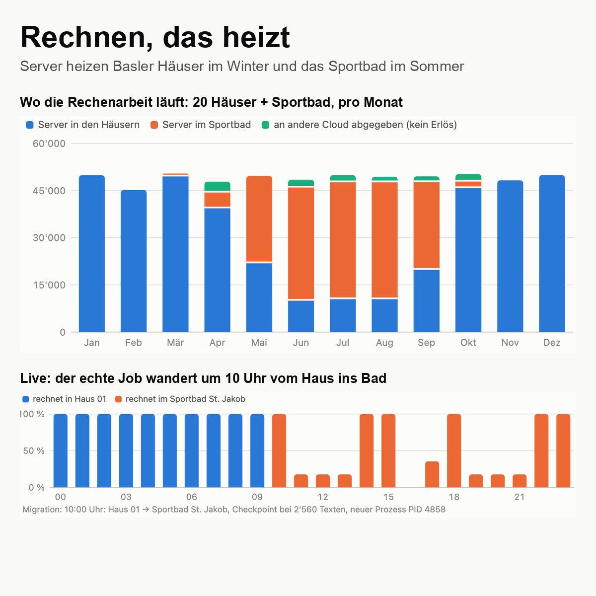

# Rechnen, das heizt 🔥💻

**Computer, die KI-Aufträge rechnen, werden warm. Wir stellen sie in Basler Keller und heizen damit Häuser – im Sommer das Sportbad.**

Hackathon-Projekt von Team Holyhackers zum Case *«Useful Load ⇒ Useful Heat»* von DigitalHeat.



## Die Idee in 4 Sätzen

1. Ein Server macht aus Strom fast nur Wärme. Normalerweise wird sie weggekühlt, das ist verschwendet.
2. Wir stellen pro Haus **8 Server** in den Keller. Sie rechnen nur dann, wenn das Haus Wärme braucht, und decken so **93 %** von Heizung und Warmwasser. Der Haushalt bekommt die Wärme gratis.
3. Im Sommer braucht das Haus kaum Wärme. Darum schickt ein **Wärme-Router** die Arbeit dann ins **Sportbad St. Jakob**, das genau im Sommer geheizt werden muss.
4. Bezahlt wird die Rechenzeit von Firmen, deren Daten in der Schweiz bleiben müssen (Pharma, Banken, Spitäler). Wir sagen ihnen am Vortag verbindlich zu, wie viele Stunden sie bekommen. Grundlage ist die Wetterprognose.

## In 3 Schritten starten

Du brauchst einen Mac oder Linux-Rechner mit **Python 3.10 oder neuer**.

```sh
# 1. Einmalig: Umgebung einrichten (lädt beim ersten Mal ein kleines KI-Modell aus dem Internet)
python3 -m venv .venv
.venv/bin/pip install -r requirements.txt

# 2. Dashboard öffnen → http://localhost:8765
bash dashboard/starten.sh

# 3. In einem zweiten Terminal: Live-Demo, der echte Job wandert vom Haus ins Bad (ca. 2 Minuten)
.venv/bin/python src/scheduler/live.py --flotte --sekunden 3
```

Während die Demo läuft, zeigt das Dashboard unten bei **«Echter Job, live gesteuert»**, wo der Job gerade rechnet.

Ohne Installation geht es auch: `dashboard/artifact/index.html` direkt im Browser öffnen. Diese Fassung zeigt eine Aufzeichnung der Demo.

## Was liegt wo?

| Ordner | Was drin ist | Wichtigste Datei |
|---|---|---|
| `docs/` | Alles zum Lesen: Case, Ergebnisse, Kosten, Pitch | **[`docs/RESULTATE_EINFACH.md`](docs/RESULTATE_EINFACH.md)**, erklärt alle Resultate ohne Fachbegriffe |
| `src/` | Der Code. Der Scheduler entscheidet jede Stunde, welcher Server rechnet | `src/scheduler/kern.py` (die Regel), `router.py` (verteilt auf Standorte) |
| `dashboard/` | Die Webseite mit allen Diagrammen und Schiebereglern | `dashboard/index.html` |
| `daten/` | Eingangsdaten (Wetter, Strompreise, Aufträge) und Ergebnisse als JSON/CSV | `daten/ergebnisse/` |
| `messungen/` | Was wir auf dem Laptop selbst gemessen haben (Strom, Tempo, Migration) | `messungen/MESSUNG.md` |
| `tests/` | Automatische Prüfungen, ob der Code richtig rechnet | `tests/test_scheduler.py` |
| `prototyp/` | Klick-Prototyp mit zwei Oberflächen: Pharma-Kunde und Hausbesitzer | `prototyp/README.md` |
| `submission/` | Vorübergehend: Texte und Bild für die Abgabe | `submission/SUBMISSION.md` |

Eine Liste aller Dokumente mit je einem Satz steht in [`docs/README.md`](docs/README.md).

## Die wichtigsten Zahlen

| | |
|---|---|
| Server pro Haus | 8 (je 8 Grafikkarten NVIDIA L4, zusammen 8 kW) |
| Wärme gedeckt | 93 % (Referenzhaus Basel, Wetter 2025) |
| Weggekühlte Wärme | 5 kWh im ganzen Jahr |
| Preis für den Kunden | 4,80 CHF pro Server-Stunde (12 % unter Schweizer Clouds) |
| Ergebnis für DigitalHeat | +34'300 CHF pro Haus und Jahr, Investition nach 3 Jahren zurück |
| Sportbad als Sommer-Abnehmer | aus 180'000 verschenkten Server-Stunden werden 12'500 |

**Ehrlich gesagt:** Gibt es zu wenig Aufträge, macht das System Verlust, auch mit Bad. Der Engpass sind die Aufträge, nicht die Wärme. Details und alle Grenzen stehen in [`docs/ERGEBNISSE.md`](docs/ERGEBNISSE.md).

## Was ist echt, was ist simuliert?

| Echt | Simuliert |
|---|---|
| Ein KI-Job (Texte in Vektoren umwandeln) läuft wirklich auf dem Laptop. Er wird pausiert, fortgesetzt und per Checkpoint an einen neuen Ort verschoben | Die Häuser, das Sportbad und die 20 Standorte. Jedes Haus ist ein Rechenmodell, kein echter Keller |
| Strom und Tempo des Jobs sind gemessen | Die Aufträge. Sie kommen nach dem Muster eines echten Rechenzentrums (Alibaba-Trace) |
| Wetter Basel 2025 und die Prognosen dazu (Open-Meteo, ECMWF) | Der Wärmebedarf des Sportbads, eine Schätzung (±30 %) |
| Strompreis Basel 2026 (ElCom) und Hardwarepreise (Offerten aus dem Netz) | Der Ortswechsel bei der Migration. Der Neustart ist echt, das Netz dazwischen nicht |

## Selber nachrechnen

Jede Zahl kommt aus dem Code. Alle Annahmen mit Quelle stehen in `src/scheduler/annahmen.py`.

```sh
python3 -m unittest discover -s tests       # 22 Prüfungen, ca. 6 s
python3 src/scheduler/jahr.py --server 8    # ein Haus, ganzes Jahr
python3 src/scheduler/zusage.py             # Zusage am Vortag
python3 src/scheduler/flotte.py             # 20 Häuser + Sportbad (ca. 5 min)
python3 src/dashboard_daten.py              # Zahlen fürs Dashboard neu erzeugen
```

## Mit KI gebaut

Code, Analysen und Texte entstanden mit **Claude Code** (Anthropic). Für die Design-Reviews haben wir die **gstack**-Skills verwendet (`/office-hours`, `/plan-ceo-review`). Vorlagen gab es keine. Der Prototyp in `prototyp/` wurde separat gebaut und hochgeladen.
